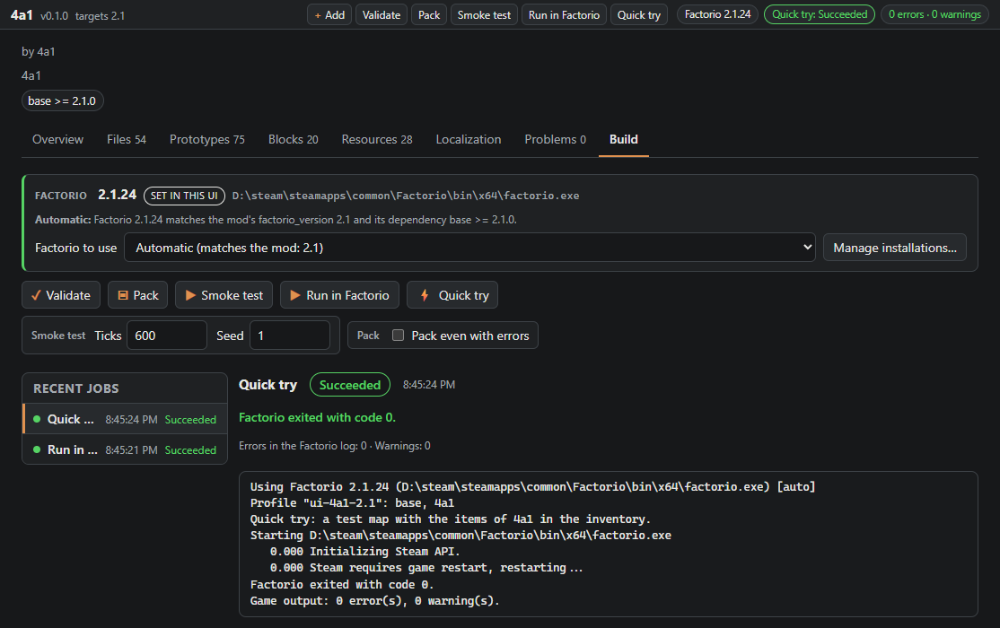
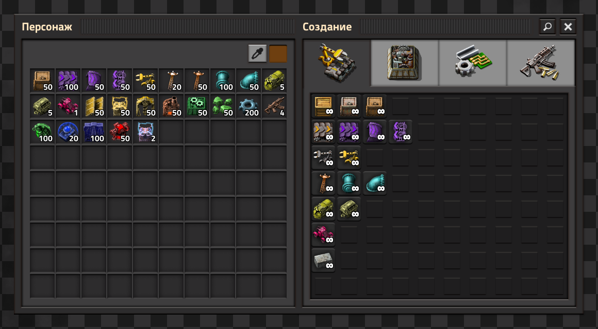
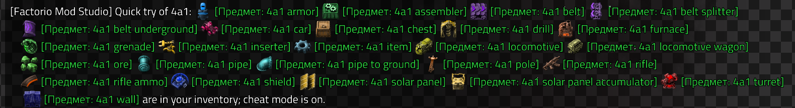

# Changelog

What changed between the releases of Factorio Mod Studio. The format follows [Keep a Changelog](https://keepachangelog.com);
versions are the tags on GitHub, and the same `fmstudio` versions are on [NuGet](https://www.nuget.org/packages/FactorioModStudio.Cli).

## [Unreleased]

### Added
- **Updates from the studio's window.** The version at the bottom of the sidebar is now a chip ("v0.3.0 · Releases", a dot
  when a newer version is out, a ring while one downloads) that opens *About and updates*: the version, the update channel,
  how this copy was installed, the last check with *Check now*, and a newer version with its release notes. *Download and
  install* runs in the background with a progress bar (MB, speed) and *Cancel*, in the dialog and in a small banner above the
  chip; then *Restart now* or *Later*. Also in the command palette.

### Changed
- **Updates are swapped in at the next start**, not while the studio runs: the download waits in `.pending-update` next to
  the program, and *Restart now* (or any later start of the window or `fmstudio`) puts it in place before anything else
  loads. A single-file program reads its own file on demand, so swapping it while running broke the first feature used
  afterwards, and the restart itself failed. `fmstudio update` works the same way.
- A failed download says why (not "see inner exception") and links to the release page, for networks that block GitHub's
  download host.

- **Far fewer false problems on real mods.** Checked against 57 published mods (bob's, 5dim, Yuoki, flib, helmod...): about
  4600 reported problems became about 950, and what is left is mostly real (missing translations, duplicate keys).
  - Locale keys before the first `[section]` (valid in Factorio, e.g. flib's `locale-identifier=...`) are no longer
    FMS040 errors.
  - Scripts only `control.lua` requires (GUI data, remote interfaces, presets for other mods) are no longer read as
    prototypes: no FMS042 for them and no stray entries on the Prototypes tab.
  - FMS042: an item with `place_as_equipment_result` takes the equipment's name (the field name was misspelled in the check);
    a further level of a technology the mod does not define (`automation-4`) takes that technology's name.
  - FMS043 no longer warns about keys of the game or a dependency: the standard sections (`fluid-name.water`) and the game's
    own ones (`description`, `gui`, `entity-status`...).
  - FMS030: `string.format` templates (`ore/%d/%d.png`) and path prefixes completed later through a variable are not missing
    files.
- The Prototypes tab: a long type (`dont-use-entity-in-energy-production-achievement`) no longer squeezes the prototype's name
  out of its row when the code viewer is open; the type and the file path are shortened instead, with the full text on hover.
- The game's own mods (base, space-age...) and installed mods: no Release readiness card on Overview, and "In the game" no
  longer offers an intro to a load they cannot do.
- The Overview's translation summary rounds down like the Localization tab: 1515 of 1519 strings is 99%, not "complete".
- Read-only mods: no "Unused only" filter or "unused" badges on Files and Resources (base showed 998 "unused" files the engine
  uses) and no "New language..." button; the Build tab says that a game mod is part of the game instead of "the mod has no valid
  factorio_version".

## [0.3.0] - 2026-11-11

See and edit content: building blocks with a colour slider, icons of your own and their names in every language, a quick try
in the game with one click, the full game from factorio.com, and the Problems and Build tabs redesigned. Includes everything from
the 0.2.1 preview.

### Changed
- **The Problems tab, redesigned** in the style of the Files tab: a filter (text, code or file), Errors / Warnings / Info
  toggles with counts, grouping by rule, by file or as one list (remembered), collapsible groups that show 20 rows and
  "Show N more", *Copy list* for bug reports, and a ⋯ / right-click menu on every problem: open the file, copy the message,
  show only this rule or this file. Click (or Enter) opens the file at the line; the arrow keys move between problems.
- **The Build tab, redesigned**: a *Factorio* card on top (the version that runs the mod, where it was found, why it was chosen,
  the picker and *Manage installations...*, with a green or red edge), the actions with icons, the options grouped under the
  action they belong to (*Smoke test*: ticks and seed, *Pack*: even with errors), then the recent jobs on the left and the
  chosen job on the right: its state, time, verdict, problems (the first 10, then *Show all*) and log. Before the first job an
  empty state explains what each action does.
- **The game version follows the mod's `base` dependency**: a mod that needs `base >= 2.0.20` is no longer given an installed
  Factorio 2.0.10 just because the branch matches. The Build tab, smoke tests, runs and `fmstudio factorio` pass over
  installations that do not satisfy it and say why; the install button offers a release that does (`base = 2.0.20` installs
  exactly that one). An installation chosen by hand is kept, with a note about the mismatch.

### Added
- **The colour of a building block, with a slider**: the *Add to mod* dialog and the Blocks tab editor have a hue slider with
  the block's icons recoloured as they will be written (from the installed game's pictures; without a game the colour still
  goes into the Lua and the game tints the icons). Adding writes the block in that colour; in the Blocks tab *Apply the colour*
  changes its `local tint` and recolours its icon and sprite files again, with Undo. Old blocks get icons of their own first.
  From the command line: `fmstudio add <block> [name] --color #rrggbb`.
- **Quick try**: one button (Build tab, the mod's header, the command palette; `fmstudio run --try`) starts Factorio on a
  fresh test map: lab tiles, always day, no enemies, cheat mode, the mod's recipes unlocked and a stack of every item the mod
  adds in the inventory (plus energy interfaces and poles to power its machines). It runs in the profile's own mods folder
  like *Run*; a small helper mod with the test scenario is added there only. For mods made for Factorio 2.0 and later.

  
  
  
- **Icons of your own for a block**: the Blocks tab shows each icon of the block (the main one, the ammo, the underground
  belt...) with *Replace...*, or a PNG dropped on it. Any PNG works (palette, grey, 16-bit too): a square picture is scaled to
  64×64, a wider one is read as an icon with mipmaps and its left square is used. *Back to the original* puts the recoloured
  original back; both with Undo. A prototype that only had the original tinted in the game gets an icon file of its own.
  Changing the block's colour leaves your own icons as they are.
- **New blocks in every language of the mod**: adding a block writes its names into the other languages too, in English with a
  `; fms: untranslated` line above each key: the keys are in place for whoever translates the files, the game shows the English
  names meanwhile, and the Localization tab lists them as untranslated (marked *English for now*). Saving a translation removes the mark; renaming and removing the block
  take the marks along. A translation that is already there is kept.
- **The full game from factorio.com**: besides the headless server, the studio installs Factorio with graphics (Windows x64 and
  Linux x64) into its own folder, where Run and the smoke tests find it. It needs a factorio.com account that owns the game:
  the installations dialog in the Build tab saves a username and token (on Windows the token is encrypted for your Windows user;
  it is only ever sent to factorio.com and never shown again) or uses the account Factorio itself is signed in to, read from its
  player-data.json each time. From the command line: `fmstudio factorio install 2.0 --game` with that account or with
  `FACTORIO_USERNAME` and `FACTORIO_TOKEN`; `fmstudio factorio remove <version> --game` deletes it.
- **Log in to factorio.com** from the installations dialog (username or e-mail and password, and the code factorio.com e-mails
  when it asks for one): the studio gets a token the way the game's launcher does and saves only the token, protected like a
  typed one; the password is used for that one request and kept nowhere. Five attempts a minute at most. Pasting a token still
  works, under *Paste a token instead*.
- **Downloads continue where they stopped**: an install that was cancelled, stalled or lost the network keeps what it got and
  asks the server for the rest next time. Before downloading, the studio checks the free disk space (archive plus unpacking)
  and says how much is needed; the progress shows megabytes ("41% (620 of 1500 MB)").
- **Run needs the full game**: when the Factorio that runs the mod is a headless server, the Build tab says that *Run in
  Factorio* needs the full game and offers to install it.
- **FMS049**: an error when the `base` dependency cannot be met by any release of the `factorio_version` the mod targets
  (`factorio_version` 1.1 with `base >= 2.0.0`): the game would refuse to load the mod.

### Fixed
- **Run with the Steam copy of Factorio**: started by the studio, the game asked Steam to start it again ("Steam requires game
  restart, restarting...") and exited at once, so the job said *Succeeded* right away, the game's errors never reached
  Problems and Cancel could not stop it. The studio now starts a Factorio from a Steam library with its Steam app id, as Steam
  does: the game stays the process the studio started (still signed in to a running Steam) and the job lasts until it closes.
  The same for Quick try, smoke tests and `fmstudio run`.

## [0.2.1] - 2026-11-09

A preview on the way to 0.3 (see and edit content): the mod as the game loads it, and a tab for building blocks.

### Added
- **Updates from GitHub**: the studio says when a newer version is out, at the bottom of the sidebar, and a copy unpacked from
  a release archive installs it with one button (the window restarts itself). `fmstudio update` does the same from the command
  line, `fmstudio update --check` only looks. A .NET tool is shown its `dotnet tool update` command.
- **Two update channels**: *releases* (X.Y.0: 0.3.0, 0.4.0) and *previews*, which also get the versions between them
  (0.3.1, 0.3.2 ...). A preview starts on the preview channel, a release on the release channel; the choice is in the sidebar
  and `fmstudio update --channel stable|preview`.

- **A menu for each mod in the sidebar** (right click, the context-menu key, or "⋯" on hover): open, pin, show in the file
  manager and, for mods in the workspace folder, delete. A deleted mod goes to the studio's trash
  (`.fmstudio/trash` in the workspace, kept 7 days) and the notice offers Undo.

- **The mod as the game loads it**: the Prototypes tab has an "In the game" mode. Factorio starts twice without a window
  (`--dump-data`, with its own config so the player's settings and saves are not touched), without and with the mod, and
  the studio lists every prototype the mod adds, changes or removes with all its values: copies made with
  `table.deepcopy` and the building blocks show "original → this mod", changes made by code (technologies that unlock
  the new recipes, other mods reacting) "before → after". The dump without the mod is kept and reused, so loading again
  takes seconds; a notice says when the mod's files changed since. Dependencies are taken from the workspace folder
  when the project names no `modsSource`.
- **A Blocks tab** for the building blocks of a mod: the list on the left (icon, name, what it is: belt tier, armor...),
  the chosen block on the right as a table "original / yours / in the game" for each number it sets (health, speed,
  inventory, crafting speed, power, damage factor...), with a reset to the original per row and a save bar that appears
  when something changed. Saving changes only those numbers in the block's Lua; comments and anything else in the file
  stay, and a file that changed in between is not overwritten. The originals come from the game: the first time a block
  is opened without game data, the studio loads the mod in Factorio by itself.
- **Rename, remove and upgrade a block safely**: the name is edited in the block's header and checked as it is typed; a
  rename changes its prototypes, file, require, locale keys in every language, icon files and every Lua string of the mod
  that names them, and adds a migration so existing saves keep their entities and items. Removing (from the "⋯" menu)
  takes out the file, require, locale keys and icons (and the shared helpers with the last block) and says which files
  still name its prototypes. Every change is listed before it is made, and the notice afterwards offers Undo. Blocks
  added by older versions of the studio can be upgraded, one or all at once: they get recoloured icon files of their own.
- A clear message when a folder cannot be moved because another program has it open (a file manager, a terminal, an
  editor), instead of "Access to the path ... is denied".

### Changed
- Versions X.Y.Z with Z > 0 are published as GitHub pre-releases and not pushed to NuGet.

### Fixed
- **Building blocks in the Prototypes tab**: what a block adds (the copies made with `copy.item`, `copy.entity`, `copy.recipe`
  and `table.deepcopy(data.raw...)`) is listed now, with its icon and "copy of gun-turret"; before, only prototypes written
  out as tables showed up. Names built from `local name = ...` and `name .. "-ammo"` are followed too, and the
  localised-name check (FMS042) now covers these prototypes as well.

## [0.2.0] - 2026-11-08

Ready for people: a desktop app in every release archive, and the real game checked in CI.

### Added
- **Desktop app**: the studio in a window of its own (Avalonia 12 with the system's web view), in the release archives
  for Windows, Linux and macOS. Something to double-click on each system: `FactorioModStudio.exe`,
  `Factorio Mod Studio.app`, `Factorio Mod Studio.desktop`; the `mods` folder next to it is the workspace.
  A double click on `fmstudio` opens the window too. Without the system web engine (Linux without WebKitGTK) the
  window says so and offers the browser.
- **Building blocks**: `fmstudio add` and the studio's Add menu put armor, enemies, belt tiers, machines, vehicles and
  more (20 blocks) into a mod, as recoloured copies of the original pictures, checked in Factorio 2.1.
- **Errors from the game in Problems**: after Run in Factorio, `factorio-current.log` is read, and the Problems panel
  lists what the newest smoke test or run reported next to the mod's own checks, with `file:line` for the mod's files.
- **Import**: a folder is checked before it is added; a folder of mods opens a list to choose from; hidden files in
  zips are skipped; a short summary after importing many mods.
- **Sidebar**: compact mod rows with icons, collapsible groups, pinned mods, an Add menu; connection status and
  Go to... in the footer.
- `fmstudio smoke` prints Factorio's last lines when the game stops with an exit code but logs no error.
- CI: the *Game* workflow smoke-tests a mod from every template and one with every building block against the real
  headless server of Factorio 1.1, 2.0 and 2.1, downloaded with `fmstudio factorio install`.

### Changed
- The item and chest templates are copies of the originals, like the blocks.
- The Files tab editor can be resized.
- The Nix flake is built only when the version or the Nix files change.

### Fixed
- Smoke tests on the headless server: it rejects `--disable-audio`, so map generation failed on every version; the
  option now goes to the full game only.
- The Files tab and the Problems tab label could show the text "null".
- Building block names may start like mod names.

## [0.1.1] - 2026-11-07

### Changed
- Moved to .NET 10 (LTS).
- Releases publish to NuGet with Trusted Publishing (no stored API key), after the GitHub release, so a NuGet problem
  never holds the archives back.

### Added
- Nix flake: `nix run github:4a11/factorio-mod-studio`, using the prebuilt .NET 10 packages.

## [0.1.0] - 2026-11-06

The first release.

### Added
- **Command line**: `init`, `new` (templates: empty, item + recipe, entity, runtime script), `validate`, `pack`, `prepare` /
  `run`, `smoke`, `log`, `factorio` (`available`, `install`, `remove`: Factorio's headless server on Linux).
- **Studio** in the browser (`fmstudio ui`), in 8 interface languages:
  - *Overview*: release readiness with a button for every open item, cards per kind of content, entry points,
    the existing prototypes the mod touches.
  - *Files*: folder tree, create, rename, move and delete with a trash and undo, upload, unused-file detection.
  - *Prototypes*: what the mod defines or changes in `data.raw`, by family or by name; recipes with ingredients and
    results.
  - *Resources*: graphics and sounds by folder, previews, the prototypes that use each picture.
  - *Localization*: languages with their progress, side-by-side editor, placeholders, translation memory.
  - *Problems* and *Build*: validate, pack, smoke test and run from the studio, managing Factorio installations,
    installing a missing version.
- Ready-to-run release archives for Windows, Linux and macOS (no .NET needed) and the `FactorioModStudio.Cli` .NET
  tool on NuGet.
- README translations of the introduction in the 7 other interface languages.

[Unreleased]: https://github.com/4a11/factorio-mod-studio/compare/v0.3.0...HEAD
[0.3.0]: https://github.com/4a11/factorio-mod-studio/compare/v0.2.1...v0.3.0
[0.2.1]: https://github.com/4a11/factorio-mod-studio/compare/v0.2.0...v0.2.1
[0.2.0]: https://github.com/4a11/factorio-mod-studio/compare/v0.1.1...v0.2.0
[0.1.1]: https://github.com/4a11/factorio-mod-studio/compare/v0.1.0...v0.1.1
[0.1.0]: https://github.com/4a11/factorio-mod-studio/releases/tag/v0.1.0
