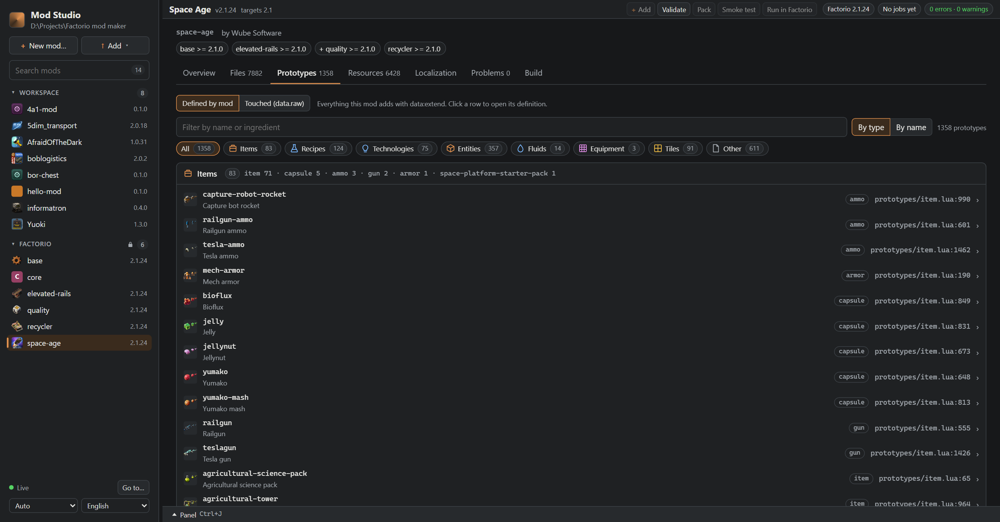
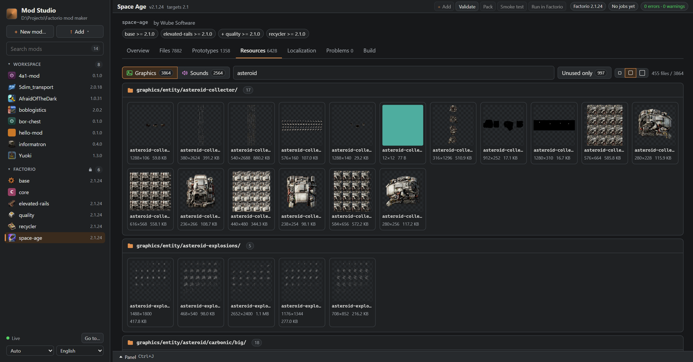
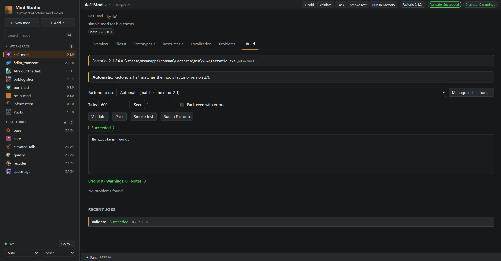

# Factorio Mod Studio

**English** · [Русский](README.ru.md) · [Deutsch](README.de.md) · [简体中文](README.zh-CN.md) · [Українська](README.uk.md) · [Polski](README.pl.md) · [Français](README.fr.md) · [Español](README.es.md)

**A local workbench for [Factorio](https://factorio.com) mod authors.** Create a mod, catch its mistakes before the game does,
translate it, pack a clean release and test-run it with an isolated set of mods: in a desktop window of its own, from the
command line or in your browser. It runs entirely on your machine and works next to your usual code editor.

> **Early version (0.2).** The logic is covered by tests; `smoke` is checked against Factorio 1.1, 2.0 and 2.1 on Linux (CI), `run` with 2.1
> on Windows. macOS has not been tried yet. Feedback and bug reports are very welcome.
> The desktop app works on Windows; for Linux and macOS it is built but not tried yet.
> Unofficial community project, not affiliated with Wube Software. "Factorio" is a trademark of Wube Software Ltd.


| Files | Localization |
| --- | --- |
|  |  |

| Prototypes | Resources |
| --- | --- |
|  |  |

## What it does

- **Start a mod in seconds.** Templates (empty, item + recipe, entity, runtime script) for Factorio 2.0 and 2.1 (all but the entity one also for 1.1) that pass every check out of the box.
- **Catch mistakes early.** `info.json`, changelog, thumbnail, broken `__mod__/` paths and `require`s, missing or broken translations: all with file and line.
- **See inside any mod.** The studio, in a window of its own or in the browser, with the file tree, a Lua editor with live checks, the prototypes and recipes the mod defines, its graphics and sounds, and the files nothing uses.
- **Bring mods in safely.** Add a mod or a whole folder of mods, such as Factorio's own `mods` folder: everything is checked before anything is copied.
- **Translate comfortably.** Side-by-side editor with progress per language, placeholder checks and suggestions from your own earlier translations.
- **Ship a clean release.** `NAME_VERSION.zip` with the right folder layout, built only when the mod validates.
- **Test without touching your game.** Run Factorio or a headless smoke test with an isolated mod set per profile; your normal mods folder is never touched. Works in CI.
- **Read logs faster.** A Factorio log condensed to its errors and warnings, merged duplicates, with the file and line and a hint.

## Roadmap

Where the project stands and what comes next. Versions are goals, not dates; the order follows feedback, so
[open an issue](https://github.com/4a11/factorio-mod-studio/issues) if something here (or missing here) matters to you.

**0.1.** The CLI (`new`, `add`, `validate`, `pack`, `prepare` / `run`, `smoke`, `log`, `factorio`) and the studio, in a desktop window or in the browser, in 8 interface languages: Overview, Files, Prototypes, Resources, Localization, Problems and Build tabs; 20 building blocks (armor, enemies, belt tiers, machines, vehicles...) as recoloured copies of the originals, checked in Factorio 2.1; whole folders of mods added with a check first.

**0.2: now, ready for people**
- [x] the desktop app everywhere: in the release archives for Windows, Linux and macOS, each with something to double-click, and one program with the CLI (a double click opens the window); *tried on Windows; built for Linux and macOS, reports welcome*
- [x] `run` and `smoke` checked against Factorio 1.1, 2.0 and 2.1, including the headless server; *`run` with 2.1 on Windows, `smoke` on the Linux headless server for 1.1, 2.0 and 2.1 in CI; macOS not tried yet*
- [x] after a run or smoke test, read `factorio-current.log` too and show its errors in Problems and Output
- [x] the prototypes the templates generate (entity, runtime script) loaded in the game, not only written from the documentation; *all four load in Factorio 2.1*
- [x] one-line install: the tool published to NuGet (`dotnet tool install -g FactorioModStudio.Cli`), no clone needed; *published: 0.2.0*
- [x] Factorio versions installed by the studio: `fmstudio factorio install 2.0` downloads the free headless server (Linux, WSL, CI), where `smoke` finds it, also from the Build tab; *the real download for 1.1, 2.0 and 2.1 smoke-tested in CI*

**0.3: see and edit content**
- [x] the Prototypes tab from the game's own data (`--dump-data`): what the mod really creates and changes, with every value, also for copies made with `table.deepcopy`; "which mod changed this item, and to what?"; *in 0.2.1 (preview)*
- [x] a properties panel for building blocks: health, speed, inventory, damage... as fields showing "original → yours", written back into the block's Lua; *in 0.2.1 (preview)*
- [ ] a quick try in the game: one button starts Factorio on a test map with the new items already in the inventory
- [x] rename or remove a block safely: its file, the require, the locale keys, the icons and every reference change together; *in 0.2.1 (preview)*
- [ ] the colour of a block chosen with a slider, with the recoloured icon previewed before it is added
- [ ] translations of new blocks: their keys added to every language of the mod, marked as untranslated in the Localization tab

**0.4: a comfortable editor**
- [ ] Lua hints in the editor: completion, hover documentation and parameter help for the Factorio API (`data.raw`, prototype fields, `game`, `script`, `defines`, events), read from the API description the installed game ships (`doc-html/*-api.json`), so they match its version
- [ ] Problems in the new style: grouped by file and rule, safe quick fixes (add a missing locale key, fix the letter case of a path)
- [ ] icons for ingredients and results that come from the base game or a dependency
- [ ] dependencies at a glance: required, optional, incompatible, and which of them are available in `modsSource`
- [ ] a recipe and technology editor: ingredients picked with their icons from the game and the dependencies, and the technology that unlocks the recipe

**0.5: release workflow**
- [ ] version bump and changelog entry in one step (`fmstudio bump patch|minor|major`)
- [ ] upload to the Factorio mod portal (opt-in, with your own API key)
- [ ] a ready GitHub Actions workflow (`fmstudio init --ci`): validate, pack and smoke-test on every push
- [ ] Build: choose the profile, extra mods and a save; a history of runs to compare

**0.6: graphics**
- [ ] a sprite editor in the studio: create and edit icons and sprites, and build animations (frames, sprite sheet, live preview) without leaving the studio

**0.7: worlds**
- [ ] a map editor: new planets and surfaces, biomes (which tiles, decoratives, resources and enemies appear where, through autoplace and noise expressions) and map generation settings, with a preview of the generated terrain

**Later**
- running tests written for [FactorioTest](https://mods.factorio.com/mod/factorio-test) from the studio
- an editor extension (VS Code) on top of the same API

## Why

Editing Lua, debugging and unit tests are already well covered (for example by the *Factorio Modding Tool Kit* for VS Code and
*FactorioTest*). What stays tedious is the glue around them: a correct release zip, a reproducible set of mods to launch, the one
real error in a wall of log output, translations that drift apart. Factorio Mod Studio does that glue.

## Quick start

**Desktop app:** download the archive for your system from [Releases](https://github.com/4a11/factorio-mod-studio/releases/latest) and unpack it; no .NET needed. Double-click `FactorioModStudio.exe` (Windows), `Factorio Mod Studio.app` (macOS) or `Factorio Mod Studio.desktop` (Linux): the studio opens in a window of its own, with a `mods` folder next to it for your mods. The release notes say what Linux and macOS need first.

**From source** (needs the [.NET 10 SDK](https://dotnet.microsoft.com/download)):

```sh
git clone https://github.com/4a11/factorio-mod-studio
cd factorio-mod-studio
dotnet run --project src/FactorioModStudio.Desktop -c Release   # your mods go into ./mods
```

**As a .NET tool** (needs the [.NET 10 SDK](https://dotnet.microsoft.com/download)):

```sh
# 1. Install the `fmstudio` tool (once)
dotnet tool install --global FactorioModStudio.Cli

# 2. Create a mod in any folder you like and open the studio
cd ~/factorio-dev
fmstudio new my-mod --template item-recipe   # a ready-to-run mod in ./mods/my-mod
fmstudio ui                                  # every mod in ./mods, in your browser
```

A typical loop: the buttons at the top of every mod in the browser, or the same in the terminal from the mod's folder:

```sh
cd mods/my-mod
fmstudio validate      # what is wrong, with file:line
fmstudio pack          # dist/my-mod_0.1.0.zip
fmstudio smoke         # load it headless for 600 ticks; fails on any error
fmstudio run           # start Factorio with only this mod and its dependencies
```

Factorio is found automatically (the usual install folders, `FACTORIO_PATH`, or installations you add in the UI); the version that
matches the mod's `factorio_version` is used.

## Documentation

- [Install](#install) · [Commands](#commands) · [Creating a mod](#creating-a-mod) · [Several Factorio versions](#several-factorio-versions) · [Configuration](#configuration) · [Smoke test](#smoke-test)
- The studio: [desktop app, overview and tabs](#graphical-mod-browser) · [Build tab](#build-tab-validate-pack-smoke-test-and-run) · [Files tab](#files-tab) · [Search](#search-api) · [Localization editor](#localization-editor)
- [Validation rules](#validation-rules) · [Translating the interface](#translating-the-interface) · [CI example](#ci-example) · [Development](#development) · [Architecture](#architecture) · [Roadmap](#roadmap)

## Install

Ready-to-run builds for Windows, Linux and macOS (no .NET needed) are on the [Releases](https://github.com/4a11/factorio-mod-studio/releases/latest) page: unpack the
archive and double-click the desktop app (see [Quick start](#quick-start)); put the folder on your `PATH` to use the
`fmstudio` command anywhere. Building from source requires the [.NET 10 SDK](https://dotnet.microsoft.com/download).

The desktop app: `dotnet run --project src/FactorioModStudio.Desktop -c Release`, or `dotnet build` it and start
`src/FactorioModStudio.Desktop/bin/Release/net10.0/FactorioModStudio` (`.exe` on Windows). The command-line tool:

```sh
dotnet tool install --global FactorioModStudio.Cli   # from NuGet; update with `dotnet tool update -g`
fmstudio help
```

From a clone: `dotnet pack src/FactorioModStudio.Cli -c Release -o ./nupkg` and `dotnet tool install --global FactorioModStudio.Cli --add-source ./nupkg`,
or run it without installing: `dotnet run --project src/FactorioModStudio.Cli -- <command>`.

## Commands

| Command | What it does |
| --- | --- |
| `fmstudio init` | Creates `fmstudio.json` (optional configuration) in the project folder. |
| `fmstudio new <name>` | Creates a new mod from a template (see "Creating a mod"). |
| `fmstudio validate [mod-dir]` | Static checks of `info.json`, `changelog.txt`, the thumbnail and file references in Lua. |
| `fmstudio pack [--out dir] [--force]` | Validates, then builds `NAME_VERSION.zip` with the correct top-level folder. Output goes to `dist/`. |
| `fmstudio prepare [profile]` | Builds an isolated mods folder for a profile (your mod, its dependencies and `mod-list.json`). |
| `fmstudio run [profile]` | Prepares the profile and starts Factorio with `--mod-directory` pointing at it. |
| `fmstudio log <file>` | Summarizes errors and warnings of a Factorio log: location, merged duplicates, hints. |
| `fmstudio smoke [profile]` | Headless test: generates a map (or loads the profile's save), simulates N ticks, fails on any log error. |
| `fmstudio factorio [--json]` | Lists the Factorio installations found (id, version, where each came from) and the one chosen for the project's mod. |
| `fmstudio factorio available` / `install [version]` / `remove <version>` | Factorio's headless server releases; download one into the studio's folder (Linux only); delete it again. `--game` installs or removes the full game instead (Windows x64, Linux x64; needs a factorio.com account that owns Factorio). See "Several Factorio versions". |
| `fmstudio ui` | Opens the graphical mod browser in your web browser (see below). |

Common options: `--project <dir>` (default: current directory), `--factorio <path>`, `--json` (for `validate`, `log`, `smoke`, `factorio`).
Exit codes: `0` ok, `1` problems found, `2` usage or configuration error — so every command can gate a CI job.

### Creating a mod

`fmstudio new <name>` scaffolds a ready-to-validate mod in the workspace folder (`mods/` by default; override with `--out <dir>`).
The same templates are available in the browser UI under **New mod…**. Every template passes `fmstudio validate` and `fmstudio pack`
without any issue, includes a generated 144x144 thumbnail, a `changelog.txt` and an English locale file.

| Template | Contents |
| --- | --- |
| `empty` (default) | `data.lua` and `control.lua` with explanatory comments only. |
| `item-recipe` | One item with a generated icon and a recipe (2 iron plates), available from the start. |
| `entity` | A placeable container (`<name>-chest`) with item, recipe, technology and generated sprites. |
| `runtime-script` | `settings.lua` (startup, runtime-global and per-player settings) and a `control.lua` with `storage` (`global` for 1.x), an event handler, a console command and `on_nth_tick`. |

`--factorio-version <MAJOR.MINOR>` (default `2.0`; the UI has a *Factorio version* selector) sets `factorio_version` and the
`base >= <version>.0` dependency of the new mod. Each template lists the versions it is valid for (`new --list`): `empty`,
`item-recipe` and `runtime-script` support 1.1, 2.0 and 2.1; `entity` is offered for 2.0 and 2.1 only (its prototypes were not
checked against 1.1). Asking for an unsupported combination is an error; in the UI such templates are greyed out with the reason.
The generated code is written from the documentation and has not been verified in the game.

### Several Factorio versions

A mod targets one game version (`factorio_version` in `info.json`, e.g. `1.1`, `2.0`, `2.1`); keep one branch per version. `run`,
`smoke` and the UI's Build tab choose the installed Factorio whose `MAJOR.MINOR` equals the mod's, the newest patch release if there
are several. When the mod's `base` dependency names a version (`base >= 2.0.20`, `base = 2.0.20`, `base < 2.1.0`), installations
that do not satisfy it are passed over, and the reason says so ("Factorio 2.0.10 matches the mod's factorio_version 2.0, but the
mod needs base >= 2.0.20"); an installation of unknown version never satisfies it. Candidates (merged by executable path) come from:

1. installations added in the UI (stored in `.fmstudio/settings.json`; the CLI reads them too),
2. the `FACTORIO_PATH` variable,
3. `factorioPath` in `fmstudio.json`,
4. automatic discovery: the usual install folders, their sibling folders named `factorio*` (`Factorio-1.1`, `factorio_2.0.76`, ...;
   also next to the installations above) and the sub-folders of `<user data dir>/FactorioModStudio/factorio/`
   (`FMS_DATA_DIR` replaces `<user data dir>/FactorioModStudio`). Only direct children are inspected, links are not followed.

The version is read from `data/base/info.json`; the executable is never started to find it out. `--factorio <path>` is used exactly as
given (a mismatch with the mod's `factorio_version` or its `base` dependency only prints a warning). Without a matching installation
the command fails and names the versions it found. `fmstudio factorio` shows the candidates and the pick; the UI's version selector
can override the pick for one mod (a mismatch is then noted, not refused).

**Installing a version.** The studio can download Factorio's *headless server* (the game without graphics, made for servers: free,
no account and much smaller than the game; enough for `smoke`, not for playing) into its own folder, where the discovery above finds it:

```sh
fmstudio factorio available           # releases per branch (--all: every release; --json)
fmstudio factorio install 2.0         # the newest 2.0 release; also 2.0.72, stable or latest
fmstudio factorio install             # the newest release of the project mod's factorio_version
fmstudio factorio remove 2.0.72       # only versions the studio installed
```

The headless server is published for Linux x64 only, so this works on Linux, in WSL and in CI; on Windows and macOS the command
says so and downloads nothing. Versions come from Factorio's updater (`updater.factorio.com/get-available-versions`), the archive from
the documented download address (`factorio.com/get-download/<version>/headless/linux64`, HTTPS only, at most 512 MB) and is unpacked
with the system's `tar` into `<user data dir>/FactorioModStudio/factorio/<version>-headless/`. A version is accepted only as
MAJOR.MINOR.PATCH; the unpacked game has to report that version in `data/base/info.json` before it is moved into place, and a failed
or interrupted install leaves nothing behind. Installing a version that is already there downloads nothing.

**The full game.** With a factorio.com account that owns Factorio, the studio also installs the game with graphics, for `run` and
for trying the mod by hand:

```sh
fmstudio factorio install 2.0 --game   # the newest 2.0 release of the full game
fmstudio factorio remove 2.0.72 --game
```

It works on Windows x64 (the `win64-manual` zip, no installer) and Linux x64 (`linux64`); macOS gets a disk image, so there the
command says to install the game yourself and add it in the UI. The archive comes from
`factorio.com/get-download/<version>/alpha/<package>` with the account's username and token (HTTPS only, at most 8 GB), is unpacked
into `<user data dir>/FactorioModStudio/factorio/<version>-game/` and checked the same way as the headless server. The account is
taken from, in this order:

1. the `FACTORIO_USERNAME` and `FACTORIO_TOKEN` variables (CI);
2. the account saved in the Build tab, in `<user data dir>/FactorioModStudio/factorio-account.json`, outside every workspace: on
   Windows the token is encrypted for the current Windows user (DPAPI), elsewhere the file is readable by its owner only;
3. when chosen in the Build tab, the account the installed game is signed in to: its `player-data.json` (`service-username`,
   `service-token`) is read each time and nothing is copied from it.

The token is sent only to factorio.com and appears in no message, log line or API answer. When factorio.com does not accept it (or
the account does not own the game) the install fails with that reason and leaves nothing behind. The token is on your profile page
at factorio.com.

**A missing version.** When no installed Factorio matches the mod's `factorio_version` (and its `base` dependency),
`fmstudio smoke --install` downloads the newest headless release of that branch, or the exact release a `base = x` / `base <= x`
dependency pins, and goes on with the test (handy in CI); without `--install` the error names the command to run. `fmstudio factorio
install` without a version picks the same release.
`run` starts the game itself, so it never picks one of these headless servers (and refuses `--install`); the Build tab's *Run in
Factorio* skips them in the same way, while *Smoke test* may use them.

**In the Build tab.** When no installation matches the mod, a box under the version line offers *Install Factorio 2.0.76 (headless)*
for the mod's branch (a release that satisfies its `base` dependency), with a progress bar and *Cancel*; afterwards the installation
is picked automatically and *Smoke test* is enabled. With a factorio.com account the box also offers *Install Factorio 2.0.76 (full
game)*; where the headless server cannot run (Windows) it offers only that, or a button that opens the account form. *Manage
installations...* has *Install a Factorio version* for any branch (*Install* for the headless server, *Install full game*), marks
the studio's installs as *headless* or *full game* and removes them. Its *Full game* part sets the account: a username and token,
or *Use &lt;name&gt; (signed in to Factorio on this computer)* when the game's `player-data.json` has one; *Forget* deletes the saved
account. Where neither can be installed (macOS) the box says so instead of offering a download. One install runs at a time for
the whole studio; reloading the page picks it up again.

| Request | Result |
| --- | --- |
| `GET /api/factorio/available` | `{ platformProblem, stable, experimental, branches: [ { branch, newest, count } ], installed: [versions], game: { platformProblem, installed: [versions], account } }`; `platformProblem` is about the headless server, `game.platformProblem` about the full game; when both are set nothing is asked from Factorio and `branches` is empty. The release list is kept for 10 minutes |
| `POST /api/factorio/install` `{ "version": "2.0" \| "2.0.76" \| "stable" \| "latest", "game"?: true }` | `202` `{ install }` and the install runs in the background; `400` bad version, unsupported platform or (with `game`) no account, `404` no such release, `409` `{ error, install }` another install runs, `502` / `504` Factorio's updater failed or did not answer |
| `GET /api/factorio/install` | `{ install: { version, state, received, total, error, path, alreadyInstalled, game } \| null }`; `state`: `downloading`, `unpacking`, `succeeded`, `failed`, `cancelled` |
| `POST /api/factorio/install/cancel` | the install; `409` nothing runs |
| `DELETE /api/factorio/install/{MAJOR.MINOR.PATCH}[?game=true]` | `{ removed, game }`; `400` not a version, `404` not installed by the studio, `409` being installed |
| `GET /api/factorio/account` | `{ account: { source, username, gameUsername, useGame } }`; `source`: `env`, `studio`, `game` or null. The token is never returned |
| `PUT /api/factorio/account` `{ "username", "token" }` or `{ "useGame": true }` | saves the account, answers like `GET`; `400` not a username / token, `409` (`useGame`) the game is not signed in |
| `DELETE /api/factorio/account` | forgets the saved account, answers like `GET` |

The writes need the session token and pass the same-origin check like every other write. `GET /api/factorio/installations` marks
these installs with `"headless": true` or `"managedGame": true`.

```sh
fmstudio new --list
fmstudio new my-mod                                   # empty template, in ./mods
fmstudio new my-chest --template entity --title "My Chest" --author "Jane Doe" --description "Adds a chest."
fmstudio new my-mod --out ../other-folder --json      # machine-readable result
```

Names use letters, digits, `-` and `_` (up to 100 characters). Title and author are optional: the title defaults to the humanized
name (`hello-world` becomes "Hello World"), the author to the `FMS_AUTHOR` environment variable, else "Your Name". An existing mod folder is
never overwritten (exit code 2). Set `FMS_AUTHOR` once in your shell profile to stop typing `--author`.

> The Factorio 2.0 prototype formats in the templates (and `storage` instead of `global`) are written from the documentation and have **not
> been verified in the game**. If Factorio complains, check `fmstudio log` and the official prototype documentation.

### Configuration

`fmstudio.json` is optional. Comments and trailing commas are allowed.

```jsonc
{
  "modPath": ".",                       // folder with info.json, relative to this file
  "workspace": "mods",                  // folder with mods you work on; the UI discovers and edits them
  "factorioPath": null,                 // executable or install folder (or set FACTORIO_PATH)
  "modsSource": "path/to/factorio/mods",// where dependencies are taken from
  "profiles": {
    "default": {},
    "with-flib": {
      "mods": ["flib >= 0.15.0"],       // extra mods on top of your mod's required dependencies
      "args": [],                       // extra Factorio command-line arguments
      "save": null                      // load this save instead of generating a map
    }
  }
}
```

Profiles live in `.fmstudio/profiles/<name>/` (add `.fmstudio/` and `dist/` to your `.gitignore`).
Required dependencies listed in `info.json` are resolved transitively from `modsSource`, using the highest available version.
Your normal Factorio mods folder is never touched. `mod-settings.dat` inside a profile is preserved between runs.

### Smoke test

```sh
fmstudio smoke --ticks 600
```

Runs `factorio --create` and `factorio --benchmark <save> --benchmark-ticks N` with the profile's mods and parses the output.
It catches mods that fail to load and errors thrown from `control.lua` in the first ticks. It does **not** replace real tests
of your mod's behaviour; use a framework such as FactorioTest for that.

### Graphical mod browser

```sh
fmstudio ui                                # browse the mod in the current folder + the ./mods workspace
fmstudio ui --workspace <folder>           # use another workspace folder
fmstudio ui --mods <mods-folder>           # ...plus installed mods (read-only; zips or unpacked folders)
```

Opens a local page where you pick a mod and look inside it.

**Desktop app.** `FactorioModStudio` (the project `src/FactorioModStudio.Desktop`) shows the same studio in a window of its own
(Avalonia 12), without a browser: the page is drawn by the system's web engine (WebView2 on Windows, WebKit on macOS, WebKitGTK on
Linux). Like `fmstudio ui` it serves the studio on the loopback interface only, here on a free port, with the folder it is started
in as the project and that folder's `mods` as the workspace (created when missing). Closing the window stops everything, Factorio
processes started from the Build tab included. The web engine keeps its data in `<user data dir>/FactorioModStudio/webview`.
It has been tried on Windows; on Linux the WebKitGTK package (`webkit2gtk-4.1`) is expected to be needed, which is not verified yet.

**Workspace.** Put your mods (one unpacked folder each, with an `info.json`) into the workspace folder, `mods` by default
(set `"workspace"` in `fmstudio.json` or pass `--workspace`). They show up under *Workspace* in the sidebar and are watched
live: new mods, new/changed/deleted files and edits made in your code editor appear in the browser within a moment (the
"Live" indicator at the bottom left). Files of workspace mods (and of the project mod) can be edited in the built-in editor:
`.lua`, `.cfg`, `.json`, `.txt` and `.md`, Ctrl/Cmd+S to save, *New file…* on the Files tab. If the file changes on disk
while you have unsaved edits, you get a choice between loading the disk version and overwriting it. Installed mods, zips and
the game's data are always read-only.

**Lua highlighting and checks.** In the editor, `.lua` files are syntax-highlighted (keywords, strings, numbers, comments and the
common Lua/Factorio globals; files over 300 KB are shown as plain text). About 400 ms after you stop typing the buffer is sent to
`POST /api/lint`, which runs a quick *structural* check. Problems get a red wavy underline, a marker in the line-number gutter and
a counter in the title bar (click it to jump from problem to problem); the message is shown in the status line when the caret is on
that line. This is not a full Lua parser: it does not check expressions, types, undefined variables or Factorio's API, and it can
miss errors that Lua itself reports. Factorio remains the source of truth.

| Code | Meaning |
| --- | --- |
| `LUA001` | Unterminated string (reported at the opening quote). |
| `LUA002` | Unterminated long string or comment (`[[ ... ]]`, `--[==[ ... ]==]`). |
| `LUA003` | Unmatched, mismatched or unclosed bracket `( ) [ ] { }`. |
| `LUA004` | Unexpected `end`, `until`, `else` or `elseif` with no matching open block. |
| `LUA005` | Block still open: `function`, `if`, `for`, `while`, `do` (missing `end`) or `repeat` (missing `until`). |

**Adding mods.** Drag a mod `.zip` or a mod folder anywhere onto the page, or use *Add mod…* / *Add folder…* in the sidebar.
The mod (at the top level or inside one folder, with an `info.json` that has a valid `name` and `version`) is copied to
`<workspace>/<name>` and opened. An existing folder is never overwritten (you get an "already exists" message with a link to
it). Only text, image and audio files (`.lua .cfg .json .txt .md .csv .png .jpg .jpeg .ogg .wav .mp3 .flac`) are imported;
other and hidden files are skipped. Limits: 200 MB per zip, 50 MB per uploaded file, 500 MB unpacked, 20000 files.

A folder is checked before anything is uploaded. A single mod with a problem (a broken `info.json`, too many files, already in
the workspace) is reported right away. A folder of mods, such as Factorio's own `mods` folder, opens a list of what was found:
every sub-folder with an `info.json` and every top-level `.zip`, each with its version, size and verdict. Mods that are already
in the workspace, have a broken `info.json` or exceed a limit cannot be selected; when a mod is there in several versions, only
the newest is offered. Folders without an `info.json` and loose files (`mod-list.json`, `mod-settings.dat`) are left out.

**Layout.** With a mod open, a bar at the top of the page stays visible on every tab: the mod's title, version and target Factorio
version, the buttons *Validate*, *Pack*, *Smoke test* and *Run in Factorio* (plus *Cancel* while a job of this mod runs), a badge
with the Factorio installation chosen for the mod (click: the Build tab), a chip with the state of the latest job (click: its
output) and the problem counter ("N errors · M warnings", click: the Problems list). The buttons use the same jobs and the same
rules as the Build tab, so a job started in one place is shown in the other. Below the page there is a collapsible **bottom
panel** (Ctrl/Cmd+J, closed by default; drag its top edge or use the arrow keys to resize it, double-click resets) with three
tabs: *Problems* (errors first; Enter or a click opens the file at the line), *Output* (live log of the latest job of the mod; it
opens by itself only when a job is started from the bar or the palette) and *Search*. The sidebar width can be changed the same way
(drag its right edge, ←/→, double-click resets). The *Theme* selector next to the language selector switches between *Auto*
(follows the system, also while the page is open), *Light* and *Dark*. The page remembers the theme, the sidebar width, the bottom
panel, the last mod and tab and the open editor tabs of each mod in the browser (`localStorage`, key `fms.ui.v1`); the last mod,
tab and editor tabs are restored only when the address has no `#/...` route.

**Editor tabs.** Every file you open (from the Files tab, a problem, a search result, quick open or a link) gets its own tab in
the viewer with its own text, unsaved changes, caret, scroll position, undo history, problems and conflict banner; a dot marks
unsaved changes and a tab of a file that was deleted on disk is struck through. At most 20 tabs are open: opening another one
closes the least recently used tab without unsaved changes (or refuses when all have some).

**Search in a mod.** Ctrl/Cmd+Shift+F (or *Find in mod* in the palette) opens the *Search* tab of the bottom panel: plain text or
a regular expression (the *.\** toggle), case-insensitive unless *Aa* is on, results grouped by file; Enter or a click opens the
file at the match and selects it. Typing searches after 250 ms; a note says when files changed since the last search.

**Quick open and commands.** Ctrl/Cmd+P opens the palette with the files of the open mod (fuzzy match, recently opened files
first, `path:line` or `path:line:col` jumps to a line; without an open mod it lists the mods). Ctrl/Cmd+K, F1 and
Ctrl/Cmd+Shift+P start it in command mode (`>`): go to a tab, open a mod, validate / pack / smoke test / run, new mod, add a mod,
toggle the panel, find in mod, save, close tabs, theme and language. Commands that do not apply right now are left out. The
sidebar button *Go to…* opens it too.

| Shortcut | Action |
| --- | --- |
| Ctrl/Cmd+P | Quick open a file |
| Ctrl/Cmd+K, F1, Ctrl/Cmd+Shift+P | Command palette |
| Ctrl/Cmd+J | Show / hide the bottom panel |
| Ctrl/Cmd+Shift+F | Search in the mod |
| Ctrl/Cmd+S | Save the active file |
| Ctrl+W | Close the active tab |
| Ctrl+Tab, Ctrl+Shift+Tab, Ctrl+PageDown, Ctrl+PageUp | Next / previous tab |
| Esc | Close the active tab (the palette and dialogs keep Esc for themselves) |

What the tabs show:

* **Overview** — a release-readiness checklist (thumbnail, changelog entry for the version, localised mod name, errors, packed zip) with a
  progress bar and a button for each open item (open the file, go to Problems / Localization / Files / Build); clickable cards with counts
  that lead to the matching tab; entry points (`data.lua`, `control.lua`, `settings.lua`, migrations); and which existing prototypes the mod
  touches via `data.raw`. Hovering a dependency in the header explains its prefix (`!`, `?`, `(?)`, `~`).
* **Files** — a folder tree (or the files grouped by type), with a built-in viewer (Lua and text with line numbers, images, audio) and file management, see below.
* **Prototypes** — every prototype the mod defines (or, in the *Touched (data.raw)* mode, every existing prototype it changes), with
  display names from the locale files and icon previews; click to jump to the source line. *By type* groups them into collapsible
  families (items, recipes, technologies, entities, fluids, equipment, tiles, settings, other); *By name* shows one row per object,
  because an item, its recipe and its entity usually share a name (each type chip opens its own definition). A row of family chips
  with counts filters the list; choosing a family shows a second row with its types (the ten most common, the rest behind *+N*).
  *No localised name* keeps the prototypes the validator reports with FMS042. Recipe rows show what they craft (ingredients →
  results, category and time; both the Factorio 2.x format and the older `result` / `normal` style), and the filter also matches
  ingredient and result names, so typing `iron-plate` lists the recipes that use or make it.
* **Resources** — the mod's graphics and sounds, one kind at a time, in a collapsible section per folder: a name filter, *Unused only*
  (the same static check as the Files tab) and three preview sizes. Image tiles show the pixel size, the file size and which prototypes
  use the image as their icon (click to open the definition); sounds play in one shared player and show their length. The ⧉ button copies
  the file's Lua path (`__mod-name__/graphics/...`). Locale files are covered by the Localization tab.
* **Localization** — a translation editor, see below.
* **Problems** — the same findings as `fmstudio validate`.
* **Build** — validate, pack, smoke-test and run the mod without leaving the browser, see below.

If Factorio is found (`--factorio`, `FACTORIO_PATH`, `factorioPath`, an installation added in the UI or a usual folder; the newest one), the game's own `base` and `core` data is listed too, which is handy as a reference.

The Lua analysis is **static**: nothing is executed. Prototypes written out literally (the usual `data:extend({ ... })` style) are found;
ones generated by loops or helper functions are not, and the Overview says how many entries could not be resolved.

Security notes: the server listens on `localhost` only, rejects requests with a foreign `Host` header, serves files only from inside the
selected mod (by mod id plus relative path) and sends a strict Content-Security-Policy. Writing is limited to text files inside editable
mods: every write needs a random per-session token that only the served page receives (plus a same-origin check), uses `If-Match`
checks so it can never silently overwrite a newer file, refuses hidden files/folders, symbolic links and anything outside the mod,
limits files to 2 MB, and goes through a temp file and rename so a half-written file is never visible. Line endings (CRLF) and a
UTF-8 BOM of an existing file are kept. The command needs the ASP.NET Core runtime, which is included with the .NET SDK.

### Build tab: validate, pack, smoke test and run



The *Build* tab of a mod runs the same operations as the CLI and streams the output while they work:

| Button | Same as | Notes |
| --- | --- | --- |
| *Validate* | `fmstudio validate` | Works for every mod, also read-only ones and zips. Lists the findings; click one to open the file. |
| *Pack* | `fmstudio pack` | Writes `NAME_VERSION.zip` to `<project>/dist` and offers it as a download. *Pack even with errors* is `--force`. |
| *Smoke test* | `fmstudio smoke` | Validates first (errors stop it before Factorio starts), then loads the mod headless for *Ticks* ticks with the given *Seed*. Shows the verdict and the diagnostics from the Factorio log. |
| *Run in Factorio* | `fmstudio run` | Prepares the profile and starts the game; the job stays *running* until Factorio exits. |

Pack, smoke test and run need an editable mod (the project mod or an unpacked mod in the workspace); Smoke test and Run also need
a Factorio installation. The *Factorio to use* selector is *Automatic* (the installation matching the mod's `factorio_version`) or one
installation you pick for this mod (remembered in the browser); the line above it says which one is used and why, and a hint
appears when none fits. *Manage installations...* lists every installation found (version, label, path, where it came from), lets you add
and remove your own and rescan. The first log line of a smoke test or run is `Using Factorio <version> (<path>) [auto|manual]`.
*Cancel* stops the running job and kills Factorio together with its child processes. The jobs of the last runs are listed under
*Recent jobs*; click one to see its log and result again. A job that is still running is picked up again after a page reload.

Behaviour worth knowing:

* Mods run from the browser use their own profile `ui-<mod name>-<MAJOR.MINOR>` (the mod's `factorio_version`) under
  `.fmstudio/profiles/`, using `mods`, `args` and `save` of your `default` profile, so a run from the browser never touches the profiles
  you use on the command line.
* One job at a time per mod, and only one smoke test or run at a time overall (a second start answers `409`). Validate and pack of
  different mods can run in parallel.
* The server keeps the 20 most recent jobs in memory (lost on restart) and at most 5000 log lines of 4000 characters per job.
  Stopping `fmstudio ui` stops the Factorio processes it started.
* The browser never chooses the arguments, and the executable only among the installations the server itself found or validated
  (next section); the arguments are built by the server. Every start and cancel needs the
  session token and the same-origin check like any other write, job ids are random, and `/api/downloads/<file>` serves only
  `*.zip` files that lie directly in `<project>/dist`.

#### Managing Factorio installations in the browser

*Manage installations...* opens a dialog with the list. *Add installation...* shows a text field (paste an absolute path; quotes around it
are removed), an optional label and a *Browse...* button with a built-in folder browser (folders, plus files named `factorio`).
Added installations are saved per project in `.fmstudio/settings.json` (`{ "factorioInstallations": [ { "path", "label" } ] }`,
not in `fmstudio.json`, because paths are personal; at most 50). A path saved by the previous single-path setting
(`"factorioPath"`) is picked up as one entry and dropped when the file is next written. Entries whose executable vanished stay in the
list marked as not found, so they can be removed. *Rescan* drops the 5-second cache of the discovery.

Because the saved program gets executed, the server is strict:

* Only an absolute path that resolves to a file named `factorio` / `factorio.exe` (an install folder is resolved to `bin/x64/factorio`)
  is accepted, never a symbolic link; anything else is answered with `400`. The stored value is checked again before every use,
  and the file is never started while saving.
* The folder listing returns only the names of non-hidden sub-folders and of files named `factorio` / `factorio.exe`: no other
  files, no contents, sizes or dates. It needs the session token even though it is a GET, rejects foreign `Host` headers like
  every request, never reads through symbolic links or junctions (`403`), and shows at most 2000 entries.

API (JSON, `X-FMS-Token` required for POST, DELETE and the folder listing):

| Request | Result |
| --- | --- |
| `GET /api/environment?modId=ID` | `{ "factorio": { "found", "path", "error", "source", "version" }, "resolution": { "modVersion", "mode": "auto\|manual\|none", "chosenId", "reason" } }` for the installation chosen for that mod (`source`: first of `ui`, `env`, `config`, `auto`; `none` when nothing fits). Without `modId`: the newest installation. An extra `installation=<id>` describes a manual choice. `404` unknown mod |
| `GET /api/factorio/installations` | `{ "installations": [ { "id", "path", "version", "label", "sources", "valid", "removable" } ], "invalid": [ { "id", "path", "label", "error" } ] }` (recomputed at most every 5 s) |
| `POST /api/factorio/installations` `{ "path": "<absolute path of the executable or install folder>", "label"?: string }` | `201` (or `200` when the same executable was already added; the label is updated) with the list above; `400` not an absolute path to a factorio executable, bad label or more than 50 entries, `413` body over 4 KB |
| `DELETE /api/factorio/installations/{id}` | the list; `404` unknown or not added in the UI |
| `POST /api/factorio/installations/rescan` | the list, freshly discovered |
| `GET /api/fs/list?path=<absolute folder>` | `{ "path", "parent", "separator", "entries": [ { "name", "type": "dir\|file", "factorio" } ], "truncated" }`; no `path` lists the drives / `/` and the home folder; `400` bad path, `403` unreadable or a link, `404` missing |
| `POST /api/mods/{id}/jobs` `{ "kind": "validate\|pack\|smoke\|run", "ticks"?, "seed"?, "timeoutMinutes"?, "force"?, "installation"?: "<id>" }` | `202` with the job (`factorio`: `{ id, path, version, mode, reason }` for smoke and run); a smoke / run without a usable installation fails with the reason as `error`; `400` bad request, `403` read-only mod, `404` unknown mod, `409` busy (`jobId` of the active job), `413` body over 4 KB |
| `GET /api/jobs/{jobId}?after=N` | the job with the log lines numbered above `N` (`state`: `queued`, `running`, `succeeded`, `failed`, `cancelled`) |
| `GET /api/jobs?modId=ID` | recent jobs, newest first, without log lines |
| `POST /api/jobs/{jobId}/cancel` | the cancelled job; `409` if it had already finished |
| `GET /api/downloads/{file}` | a packed archive from `dist` |

### Files tab

The *Files* tab shows the mod as a folder tree (*Tree*) or grouped into scripts, locale, graphics, sounds and data (*By type*; the
choice is remembered in the browser). *Filter by name* keeps the files whose name contains the text; *Unused only* keeps graphics,
sounds and scripts that nothing in the mod refers to (the button shows how many there are; it is hidden when there are none). *Expand
all* / *Collapse all* opens or closes every folder, and the line on the right counts the files shown. Each row has a type icon and
badges for problems, unsaved changes in open tabs, entry points and
*unused* files. The "unused" check is static: `__mod__/path` strings and `require` calls in Lua are followed, entry points
(`data.lua`, `control.lua`, `settings*.lua`, ...), `locale/`, `migrations/` and scenario folders always count as used, and a path built
at run time is only seen through its literal prefix (`"__mod__/graphics/" .. name` marks everything under `graphics/` as used).

In editable mods the toolbar says where new files go (the selected folder, the folder of the selected file, or the mod root; click
empty space or *Use the mod root* to go back to the root). The toolbar and the context menu (right-click, the row's *⋯* button, the
Menu key or Shift+F10) offer *New file…*, *New folder…*, *Upload
files…*, *Rename…* (F2), *Duplicate…*, *Delete* (Del) and *Show in file manager* (also for read-only mods). Drag rows onto a folder to
move them, or drop files from your computer onto a folder or onto the drop zone under the tree (the mod root) to upload them (text files as in the editor, images and sounds as binary assets; existing
files are never overwritten, dropped folders are skipped). Names are checked before anything is sent: no `/` `\`, no leading dot, no
`..`, no Windows device names (`CON`, `NUL`, `COM1`, ...), no `<>:"|?*`, no trailing dot or space, at most 255 characters. Open editor
tabs follow a renamed or moved file with their unsaved edits; deleting closes them (after a warning when they have unsaved changes).

*Delete* moves the file or folder into a trash outside the mod (`<workspace>/.fmstudio/trash/<mod>/`) and shows a notice with *Undo*.
The trash keeps the 20 newest entries of each mod for at most 7 days. Undo fails with a message when something else now exists at
the original path.

API (same token, same-origin and `Host` rules as the other writes; only editable mods, `403` for read-only ones, `404` unknown mod; paths
are relative to the mod, hidden files, links and anything outside the mod are refused with `400`; errors as `{ "error" }`):

| Request | Result |
| --- | --- |
| `POST /api/mods/{id}/fs/mkdir?path=<folder>` | `{ "path" }`; `409` the name exists |
| `POST /api/mods/{id}/fs/move` `{ "from", "to" }` | Moves or renames a file or folder (a case-only rename works on Windows and macOS too); `{ "from", "to" }`; `400` into itself or a folder with links that would have to be copied across drives, `404` missing source, `409` target exists, `413` body over 16 KB |
| `POST /api/mods/{id}/fs/copy` `{ "from", "to" }` | Copies one file (not folders); same answers as move |
| `DELETE /api/mods/{id}/file?path=<file or folder>` | Moves it into the trash; `{ "trashId" }` |
| `GET /api/mods/{id}/trash` | `[ { "trashId", "path", "kind": "file\|folder", "deletedUtc" } ]`, newest first (no token needed) |
| `POST /api/mods/{id}/trash/{trashId}/restore` | `{ "path" }`; `404` unknown entry, `409` the original path is taken |
| `PUT /api/mods/{id}/asset?path=<file>` | Raw body: a `.png`, `.jpg`/`.jpeg`, `.ogg` or `.wav` file whose leading bytes match the extension, at most 32 MB. Needs `If-None-Match: *` to create or `If-Match: <etag>` to overwrite (`428` without, `409` `{ error, etag }` when the file changed); returns `{ "etag", "size" }`; `400` content does not match, `413` too large, `415` other extension |
| `POST /api/mods/{id}/reveal?path=<file or folder>` | Opens Explorer / Finder / the default file manager at the file (no `path`: the mod folder; for a zip mod: the archive); `204`. Works for read-only mods too |

### Search API

`GET /api/mods/{id}/search?q=<text>&regex=0|1&case=0|1` searches the text files of a mod (`.lua .cfg .json .txt .md .csv .ini`; hidden
folders such as `.git`, symbolic links and junctions are never followed). It is read-only, needs no token (like reading a file) and is
bounded: the query has 1 to 200 characters, files over 2 MB and files that are not valid UTF-8 or contain NUL bytes are skipped
(counted in `skippedFiles`), at most 2000 files are scanned, 500 matches and 100 files with matches are returned, regular
expressions (.NET syntax) have a 1 s match timeout and the whole search a 3 s budget; hitting a limit sets `truncated`.

```json
{ "query": "stack_size", "files": [ { "path": "data.lua", "matches": [ { "line": 12, "column": 5, "length": 10, "text": "<the line, at most 300 characters>" } ] } ],
  "totalMatches": 1, "truncated": false, "skippedFiles": 0 }
```

`line` and `column` are 1-based, `column` and `length` count UTF-16 code units of the full line. Files are ordered by path, matches by
position. Errors: `400` empty or too long query or an invalid regular expression (`{ "error" }`), `404` unknown mod.

### Localization editor

The *Localization* tab of a mod turns `locale/<lang>/*.cfg` into a translation table: one row per key of the source language
(`en` if the mod has `locale/en`, otherwise the first language folder), the original text next to the translation of the chosen
language. Every language is a chip with its progress (percent and a small bar; the original is marked), next to *New language…*.

* **Progress and filters.** A segmented bar shows the chosen language's translated, identical-to-original and untranslated keys.
  Filter chips with counts (*All strings*, *Untranslated*, *Identical to original*, *Extra keys*, *Placeholder problems*; empty ones are
  hidden, the placeholder count follows your edits) and a search over section, key and text narrow the table.
* **Sections.** Rows are grouped by locale section (`[item-name]`, `[entity-name]`, ...); each group header shows `translated/total`
  and a small bar. Complete sections start collapsed (unless a filter or search is active), so the open ones are where work is left.
  Long sections are shown in chunks of 200 rows (*Show more*). The key's file and line are in its tooltip.
* **Keyboard.** Enter moves to the next string, Shift+Enter inserts a line break (stored as `\n`), Alt+↓ / Alt+↑ jump to the next /
  previous untranslated string, opening its section if needed.
* **Placeholder checks.** The tokens of the original (`__1__`, `__ITEM__iron-plate__`, `__CONTROL__build__`, plural blocks
  `__plural_for_parameter_1_{...}__`, rich-text tags such as `[color=red]` / `[/color]` / `[item=iron-plate]`, and the literal `\n`)
  are shown as chips under the translation of the row being edited; a click inserts the token at the cursor. While you type, missing and unexpected tokens
  are reported live (the same rules run on the server in `LocalePlaceholders` and in the browser in `locale-placeholders.js`; the
  contents of plural blocks are not compared).
* **Suggestions.** For an untranslated key the editor shows (*From memory: ...* with a *Use suggestion* button) a translation it already knows for the same original text, taken from
  the translated rows of this language in this mod and in the other editable mods of the workspace (a local translation memory;
  nothing is sent anywhere). A suggestion is only offered when its placeholders match; it is never applied automatically.
* **Saving.** While there are unsaved changes a bar sticks to the bottom of the page with their number, *Discard changes* and *Save*
  (Ctrl/Cmd+S while the focus is in the tab). *Save* sends only the changed rows in one request. A value is a single line: a line break typed into a translation is
  stored as the two characters `\n`. Only the edited lines of the `.cfg` files change; comments, blank lines, order, indentation,
  BOM and line endings are kept. New keys go into the file that mirrors the original's file (`locale/en/main.cfg` →
  `locale/de/main.cfg`), after the last key of their section. If the files change on disk while you hold unsaved edits (or the
  save is refused because they changed), a banner offers *Reload* (which discards your edits); without unsaved edits the table
  just refreshes. Extra keys (not present in the source language) have a *Remove* button.
* **New language.** *New language…* creates `locale/<code>/` with an empty stub file (one comment line) for every file of the source
  language. Installed mods, zips and the game's data are shown read-only.

API (same token, same-origin and `Host` rules as the file endpoints; JSON, errors as `{ "error": "..." }`):

| Request | Result |
| --- | --- |
| `GET /api/mods/{id}/locale` | `{ sourceLanguage, editable, languages: [{ code, total, translated, untranslated, identical, extra, placeholderProblems }] }` |
| `GET /api/mods/{id}/locale/{lang}` | The translation table (`rows`, `summary`, `revision`) with `ETag: "<revision>"` |
| `PUT /api/mods/{id}/locale/{lang}` | Body `{ "changes": [{ "section", "key", "value" }] }` (`value: null` removes the key); needs `If-Match: "<revision>"` (428 without, 409 `{ error, revision }` if the files changed); returns `{ revision, added, updated, removed, touchedFiles }` |
| `POST /api/mods/{id}/locale` | Body `{ "code": "de" }`; 201, or 409 if the language exists |

Limits: 5000 changes and 2 MB per request, 65536 characters per value. Not included: machine translation, editing comments or renaming keys.

### Validation rules

| Code | Level | Meaning |
| --- | --- | --- |
| FMS001 / FMS002 | error | `info.json` missing / not valid JSON |
| FMS003 | error | required field (`name`, `version`, `title`, `author`) missing |
| FMS004 / FMS005 | error | invalid mod name / version |
| FMS006 / FMS007 | warning / error | `factorio_version` missing / malformed |
| FMS008 | error | malformed dependency string |
| FMS009 | warning | no dependency on `base` |
| FMS010 / FMS011 | warning | thumbnail missing / not 144x144 |
| FMS012 | info | no `changelog.txt` |
| FMS013 / FMS014 | warning | changelog does not match `info.json` version / malformed changelog |
| FMS015 | error | depends on a DLC mod (`space-age`, `quality`, `elevated-rails`) while `factorio_version` is below 2.0 |
| FMS016 | info | `factorio_version` is well-formed but not one of 1.0, 1.1, 2.0, 2.1 |
| FMS049 | error | the `base` dependency cannot be met by any release of `factorio_version` (e.g. `factorio_version` 1.1 with `base >= 2.0.0`): the game would refuse to load the mod |
| FMS030 | error | Lua references `__your-mod__/path` that does not exist |
| FMS031 | error | referenced file exists only with different letter case (works on Windows, breaks in the zip and on Linux) |
| FMS032 | error | `require("a.b")` / `require "a/b"` matches no `.lua` file of the mod (looked up next to the requiring file, then at the mod root; other mods and Factorio's lualib modules such as `util` are ignored) |
| FMS040 | error | malformed `locale/**/*.cfg` line (key before any section, line without `=`, bad section header, empty key) |
| FMS041 | warning | duplicate key in the same language and section (reported at the later one) |
| FMS042 | warning | prototype of this mod has no localised name in `locale/en` |
| FMS043 | warning | `{"section.key"}` in Lua uses a section the mod's `en` locale defines, but the key is missing |
| FMS044 / FMS045 | warning / info | a language lacks keys the default language has / has keys the default does not (one issue per language) |
| FMS046 | warning | numbered placeholders (`__1__`..`__9__`) differ from the default language's value |
| FMS047 | info | key in a non-standard section that no Lua file references (at most 30 listed, then a summary) |
| FMS048 | warning | other languages exist but there is no `locale/en` with a `.cfg` file |

Warnings and info issues never change the exit code of `fmstudio validate`; only errors (including FMS040) make it exit with 1.

The locale checks are static heuristics, written from knowledge of Factorio's behaviour and not verified against the game. The default
language is `en`. FMS042 only looks at prototypes found statically in data-stage Lua files (not `control.lua`, `settings*.lua` or
migrations), skips tables that set `localised_name`, accepts `item-name.<x>` for entities (Factorio falls back to the placing item) and
ignores unknown prototype types. FMS043 and FMS047 only see literal strings: dynamically built keys (`"section." .. name`) are not
resolved (a section used like that is excluded from FMS047), keys of the base game or other mods are not known (so FMS043 can warn about
a base-game key if the mod also defines the same section), and `__ENTITY__x__`-style references are neither checked nor compared. The
Localization tab of the UI shows per-language progress with missing and extra keys.

## Translating the interface

The web UI is available in English (default), Russian, German, Simplified Chinese, Ukrainian, Polish, French and Spanish.
Pick a language with the selector in the bottom left of the sidebar; the choice is remembered in the browser. Only the
interface itself is translated: messages produced by the validator, API errors, template descriptions and the content of
mods are shown as they are (in English).

To add a language:

1. Copy `src/FactorioModStudio.Server/wwwroot/i18n/en.json` to `<code>.json` (a BCP 47 tag such as `it` or `pt-BR`) and translate the values.
   Keep every key and every `{placeholder}`; plural keys (`something.one`, `.other`, ...) need exactly the categories
   `new Intl.PluralRules('<code>').resolvedOptions().pluralCategories` reports for that language. Leave `Factorio`, `Lua`,
   file names and codes such as `FMS001` untranslated.
2. Add `{ code: '<code>', name: '<native name>' }` to `LANGUAGES` in `src/FactorioModStudio.Server/wwwroot/i18n.js`.
3. Add the code to the `UiLanguages` allowlist in `src/FactorioModStudio.Server/UiServer.cs`.

The translations are machine-assisted and may contain mistakes or unnatural wording; corrections are welcome via pull request.

The README has translations too (`README.<code>.md`, linked at the top). They cover only the introduction (what it does, roadmap,
why, quick start) and link to this file for the documentation, so when you change those parts here, update them as well; this
English README is the reference.

## CI example

```yaml
- run: dotnet tool install --global FactorioModStudio.Cli
- run: fmstudio validate
- run: fmstudio pack
- run: fmstudio smoke --factorio /path/to/headless/factorio --ticks 600
```

## Development

```sh
dotnet build
dotnet test
node --test tests/js/*.test.mjs   # the browser-side logic: highlighter, palette, files tree, import pre-check, i18n dictionaries (Node 18+, no dependencies)
```

If `fmstudio ui` is running it locks the CLI's build output; build the tests elsewhere with
`dotnet test --artifacts-path <folder>` and set `FMS_REPO_ROOT=<repository>` so the tests can find the repository.

* `src/FactorioModStudio.Core` — library: validation, packaging, profiles, log parser, smoke test, mod inspector (Lua reading, locale, zip extraction). No console or HTTP code.
* `src/FactorioModStudio.Server` — local web host: a JSON API over Core (read, plus guarded writes), live change events (server-sent events) and the embedded UI (`wwwroot`, plain HTML/CSS/JS, no build step). The page is a set of ES modules: `app.js` (routing, sidebar, Overview and Problems, importing mods with the pure pre-check in `import-logic.js`), one module per bigger tab (`files-view.js` with the pure `files-logic.js`, `prototypes-view.js`, `resources-view.js`, `locale-view.js`, `build-view.js`), `editor-tabs.js`, `action-bar.js`, `bottom-panel.js`, `search-panel.js`, `palette.js` with the pure `palette-logic.js`, `theme.js` / `theme-init.js` and `ui-state.js`. A new module has to be added to `StaticScripts` in `UiServer.cs`.
* `src/FactorioModStudio.Cli` — the `fmstudio` command-line tool; a thin layer over Core and Server.
* `src/FactorioModStudio.Desktop` — the desktop app: an Avalonia window with the system's web view over an in-process Server; no logic of its own.
* `tests/FactorioModStudio.Tests` — xUnit tests; Factorio itself is replaced by a fake process runner.
* `examples/hello-mod` — a minimal mod that passes all checks.

## Architecture

```
clients:   desktop app (window)  |  web UI (browser)  |  CLI  |  future: editor extension
hosts:     Server (JSON API; inside the desktop app or `fmstudio ui`)  |  CLI (in-process)
core:      FactorioModStudio.Core
```

Core holds all behaviour and knows nothing about the console or HTTP; hosts only translate. New features go into Core first, with tests,
and become available to every client. The shape of the `--json` output and of the `/api` responses is the public contract.

## License

[MIT](LICENSE)
