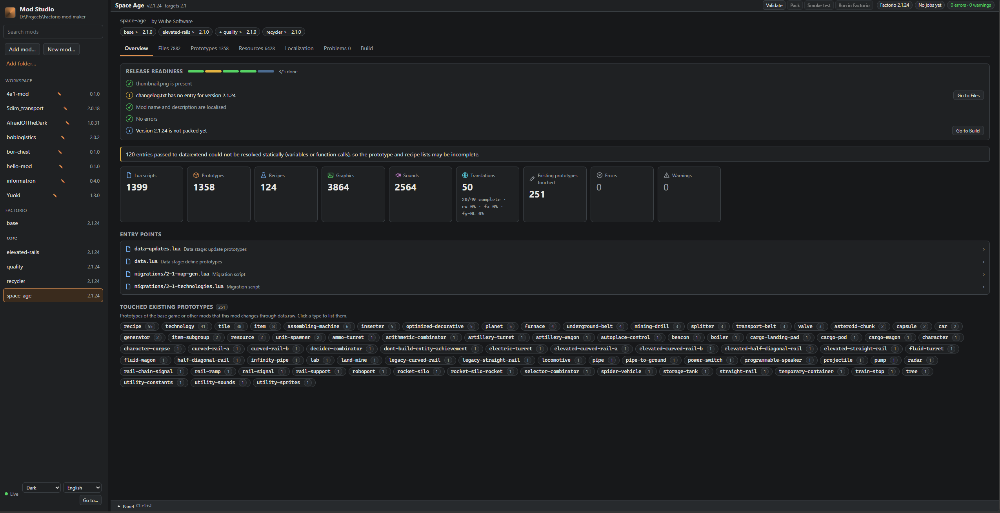
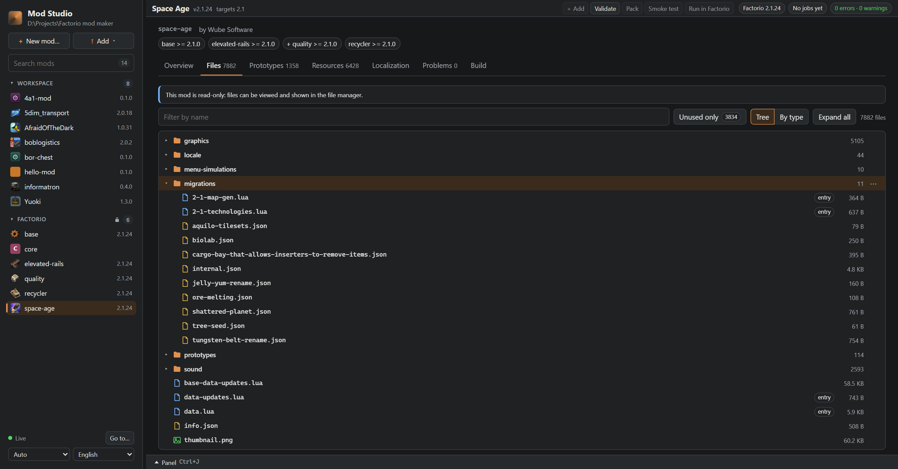
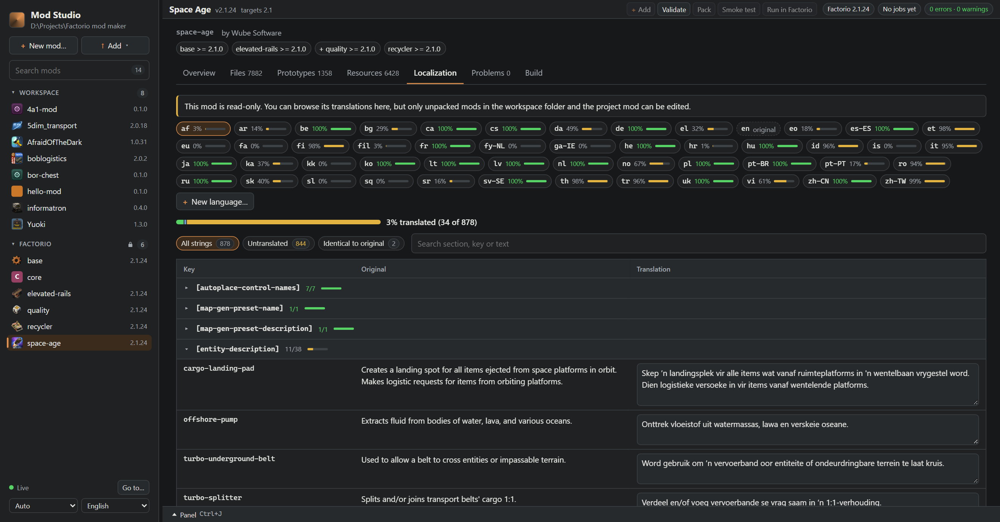

# Factorio Mod Studio

[English](README.md) · [Русский](README.ru.md) · [Deutsch](README.de.md) · **简体中文** · [Українська](README.uk.md) · [Polski](README.pl.md) · [Français](README.fr.md) · [Español](README.es.md)

**为 [Factorio](https://factorio.com) 模组作者打造的本地工作台。** 创建模组、在游戏之前发现它的错误、翻译它、打包干净的发行版，
并用隔离的模组组合试运行——可以在独立的应用窗口中、命令行中或浏览器中操作。一切都在你自己的电脑上运行，与你常用的代码编辑器并行使用。

> **早期版本（0.1）。** 逻辑已有测试覆盖；启动真实游戏（`run`、`smoke`）在 Windows 上的 Factorio 2.1 中可以正常工作，其他版本和系统尚未验证。非常欢迎反馈和错误报告。
> 桌面应用是新功能：已在 Windows 上可用，Linux 和 macOS 尚未验证。
> 非官方社区项目，与 Wube Software 无关。“Factorio”是 Wube Software Ltd. 的商标。
>
> 这是简介部分的翻译。完整文档为[英文版](README.md#documentation)；如有出入，以英文 README 为准。



| Files | Localization |
| --- | --- |
|  |  |

## 功能

- **几秒钟创建模组。** 适用于 Factorio 2.0 和 2.1 的模板（空模组、物品 + 配方、实体、运行时脚本；除实体外也支持 1.1），开箱即可通过所有检查。
- **在游戏之前发现错误。** `info.json`、更新日志、缩略图、损坏的 `__mod__/` 路径和 `require`、缺失或有误的翻译——都附带文件和行号。
- **查看任意模组的内部。** 工作室（独立窗口或浏览器）：文件树、带实时检查的 Lua 编辑器、模组定义的原型和配方、它的图形和声音，以及没有被任何地方引用的文件。
- **安全地导入模组。** 添加单个模组或整个模组文件夹（例如 Factorio 自己的 `mods` 文件夹）：复制任何内容之前都会先检查。
- **轻松翻译。** 原文与译文并排的编辑器，带每种语言的进度、占位符检查，以及来自你以往翻译的建议。
- **干净的发行版。** 目录结构正确的 `NAME_VERSION.zip`，只有在模组通过检查时才会生成。
- **测试时不动你的游戏。** 为每个配置使用隔离的模组组合启动 Factorio 或无界面冒烟测试；你平时的模组文件夹不会被改动。可在 CI 中使用。
- **更快地读日志。** 将 Factorio 日志浓缩为错误和警告，合并重复项，并附带文件、行号和提示。

## 路线图

项目现状与下一步计划。版本号是目标而不是日期；顺序取决于反馈，所以如果某一项对你很重要（或这里缺少了什么），
请[提交 issue](https://github.com/4a11/factorio-mod-studio/issues)。

**0.1：现在。** 命令行（`new`、`add`、`validate`、`pack`、`prepare` / `run`、`smoke`、`log`、`factorio`）和工作室——独立窗口或浏览器中均可使用，界面支持 8 种语言：概览、文件、原型、资源、本地化、问题和构建标签页；20 个构件（护甲、敌人、传送带等级、机器、载具……）均为原版的换色副本，已在 Factorio 2.1 中验证；整个模组文件夹添加前会先检查。

**0.2：可以交给大家使用**
- [ ] 桌面应用全面可用：加入 Windows、Linux 和 macOS 的发行压缩包，并与命令行合为一个程序（双击打开窗口）；*已在 Windows 上从源码构建运行*
- [ ] 在 Windows、Linux 和 macOS 上用 Factorio 1.1、2.0 和 2.1（包括无界面服务器）验证 `run` 和 `smoke`；*Windows 上的 2.1 已可用；CI 中已在 Linux 无界面服务器上对 1.1、2.0 和 2.1 运行 `smoke`*
- [x] 运行或冒烟测试之后同时读取 `factorio-current.log`，并在“问题”和“输出”中显示其中的错误
- [x] 模板生成的原型（实体、运行时脚本）在游戏中实际加载过，而不只是按文档编写; *四个模板均可在 Factorio 2.1 中加载*
- [x] 一行命令安装：工具发布到 NuGet（`dotnet tool install -g FactorioModStudio.Cli`），无需克隆仓库; *已发布：0.1.1*
- [x] 由工作室安装 Factorio 版本：`fmstudio factorio install 2.0` 下载免费的无界面服务器（Linux、WSL、CI），`smoke` 会自动找到它，“构建”标签页中也可以安装；*CI 中已用 1.1、2.0 和 2.1 的真实下载完成冒烟测试*

**0.3：查看和编辑内容**
- [ ] 基于游戏自身数据（`--dump-data`）的“原型”标签页：模组真正创建和修改了什么，包含所有数值，也包括用 `table.deepcopy` 复制的原型；“哪个模组修改了这个物品，改成了什么？”
- [ ] 构件属性面板：生命值、速度、物品栏、伤害……以“原版 → 你的值”字段显示，并写回构件的 Lua
- [ ] 在游戏中快速试用：一个按钮在测试地图上启动 Factorio，新内容已放在物品栏中
- [ ] 安全地重命名或移除构件：文件、require、翻译键、图标和所有引用一起修改
- [ ] 用滑块选择构件颜色，添加前预览换色后的图标
- [ ] 新构件的翻译：其键加入模组的所有语言，并在“本地化”标签页中标为未翻译

**0.4：顺手的编辑器**
- [ ] 编辑器中的 Lua 提示：Factorio API（`data.raw`、原型字段、`game`、`script`、`defines`、事件）的自动补全、悬停文档和参数提示，读取已安装游戏自带的 API 描述（`doc-html/*-api.json`），因此与其版本一致
- [ ] 新风格的“问题”页：按文件和规则分组，提供安全的快速修复（添加缺失的翻译键、修正路径的大小写）
- [ ] 显示来自基础游戏或依赖模组的原料和产物图标
- [ ] 依赖一目了然：必需、可选、不兼容，以及哪些可在 `modsSource` 中找到
- [ ] 配方和科技编辑器：用游戏和依赖中的图标选择原料，并选择解锁该配方的科技

**0.5：发布流程**
- [ ] 一步完成版本号提升和更新日志条目（`fmstudio bump patch|minor|major`）
- [ ] 上传到 Factorio 模组门户（可选，使用你自己的 API 密钥）
- [ ] 现成的 GitHub Actions 工作流（`fmstudio init --ci`）：每次 push 时检查、打包并进行冒烟测试
- [ ] “构建”页：选择配置、额外模组和存档；可对比的运行历史

**0.6：图形**
- [ ] 工作室内的精灵图编辑器：创建和编辑图标与精灵图，并直接在工作室中制作动画（帧、精灵表、实时预览）

**0.7：世界**
- [ ] 地图编辑器：新的星球与地表、生物群系（通过 autoplace 和噪声表达式决定哪些地块、装饰物、资源和敌人出现在哪里）以及地图生成设置，并可预览生成的地形

**以后**
- 在工作室中运行为 [FactorioTest](https://mods.factorio.com/mod/factorio-test) 编写的测试
- 基于同一 API 的编辑器扩展（VS Code）

## 为什么

编辑 Lua、调试和单元测试已经有很好的工具（例如 VS Code 的 *Factorio Modding Tool Kit* 和 *FactorioTest*）。
仍然繁琐的是它们之间的“胶水”工作：正确的发行版 zip、可复现的启动模组组合、在大量日志中找出唯一真正的错误、彼此不同步的翻译。
Factorio Mod Studio 负责的正是这些胶水工作。

## 快速开始

**桌面应用：** 独立窗口中的工作室。目前需从源码构建（需要 [.NET 10 SDK](https://dotnet.microsoft.com/download)）；下一个版本将加入发行压缩包。

```sh
git clone https://github.com/4a11/factorio-mod-studio
cd factorio-mod-studio
dotnet run --project src/FactorioModStudio.Desktop -c Release   # 模组放在 ./mods
```

**无需 .NET：** 从 [Releases](https://github.com/4a11/factorio-mod-studio/releases/latest) 下载适合你系统的压缩包并解压，无需安装 .NET。在 Windows 上双击 `fmstudio.exe`，
工作室会在浏览器中打开；在其他系统上运行 `./fmstudio ui`。

**作为 .NET 工具安装**（需要 [.NET 10 SDK](https://dotnet.microsoft.com/download)）：

```sh
# 1. 安装 `fmstudio` 工具（只需一次）
dotnet tool install --global FactorioModStudio.Cli

# 2. 在任意文件夹中创建模组并打开工作室
cd ~/factorio-dev
fmstudio new my-mod --template item-recipe   # 在 ./mods/my-mod 中生成可直接运行的模组
fmstudio ui                                  # 在浏览器中打开 ./mods 中的所有模组
```

典型流程：使用浏览器中每个模组顶部的按钮，或在模组文件夹的终端中执行同样的操作：

```sh
cd mods/my-mod
fmstudio validate      # 哪里有问题，附带文件和行号
fmstudio pack          # dist/my-mod_0.1.0.zip
fmstudio smoke         # 以无界面方式加载 600 tick；出现任何错误即失败
fmstudio run           # 只带这个模组及其依赖启动 Factorio
```

Factorio 会被自动找到（常见安装目录、`FACTORIO_PATH`，或在界面中添加的安装）；会使用与模组 `factorio_version` 相匹配的版本。

## 文档

完整文档（命令、配置、工作室各标签页、检查规则、API）为[英文版](README.md#documentation)。

## 许可证

[MIT](LICENSE)
